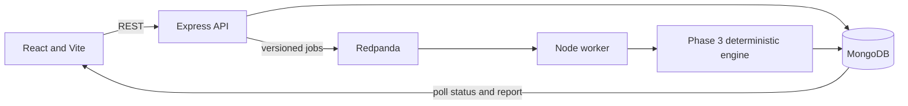

# EventGuard project specification

EventGuard is a local developer platform for checking event schema changes against registered consumers and historical payloads before deployment. Deterministic compatibility analysis, fixture replay, allowlisted handlers, and declarative invariants determine outcomes; AI is not part of execution.

## Implemented product

- React/Vite application with project selection, project management, schemas, sample validation, version comparison, consumer management, fixture management, test-run history, queued status refresh, and detailed replay reports.
- Project-scoped Express/Mongoose APIs for project/schema/consumer/fixture CRUD and schema validation/comparison.
- Deterministic Draft 2020-12 compatibility and replay engine shared by synchronous preview and the asynchronous worker.
- MongoDB persistence for resources, immutable test-run input snapshots, execution states, and structured reports.
- KafkaJS/Redpanda job transport with a v1 message envelope, Mongo-backed publication outbox, bounded worker retries, duplicate-safe claims, and a dead-letter topic for malformed or dangling references.
- Docker Compose services for MongoDB, Redpanda, API, worker, and the Vite application.

## Architecture

## Reliability and behavior

- Run execution status (`queued`, `running`, `completed`, `failed`, `cancelled`) is distinct from test outcome (`pass`, `warning`, `fail`).
- The API persists a run before broker publication. Pending sends are retried by the Mongo-backed outbox with capped exponential backoff; duplicate messages are safe because the worker claims a run through a conditional state update.
- The worker saves the detailed report and final status before committing the Kafka offset. Transient execution errors are retried up to `WORKER_MAX_ATTEMPTS`; malformed envelopes and dangling references go to `<topic>.dlq`.
- Queued runs may be cancelled. Running cancellation is not supported.
- Project deletion uses a deleting marker and ordered child cleanup, without MongoDB transactions.

## Technical constraints and limits

- Node.js JavaScript ES modules, Express, Mongoose, MongoDB, React, Vite, Axios, React Router, KafkaJS, and Redpanda.
- Schemas are validated using JSON Schema Draft 2020-12. Compatibility analysis is conservative for unsupported constructs and returns warnings; it cannot prove arbitrary application behavior.
- Only registered handler types and supported declarative invariants execute. User-provided JavaScript is never run.
- Authentication, authorization, tenant isolation, rate limiting, secret management, and audit logging are not implemented. Do not expose this local MVP to untrusted users.
- MongoDB and Kafka end-to-end behavior requires Docker services. Compose syntax was validated, but the Docker daemon was unavailable during this implementation, so container startup and the actual UI-to-worker flow were not verified here.

See [README.md](README.md), [API guide](docs/api.md), [architecture](docs/architecture.md), [worker lifecycle](docs/worker-lifecycle.md), and [testing](docs/testing.md).
